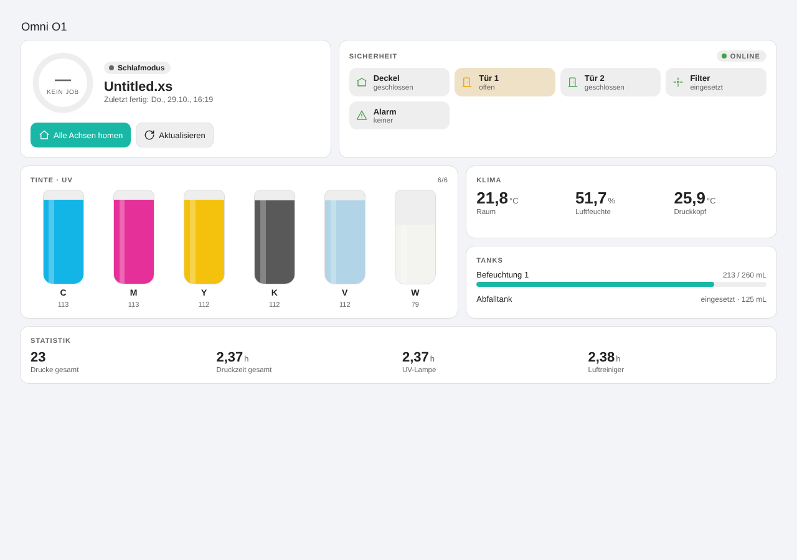
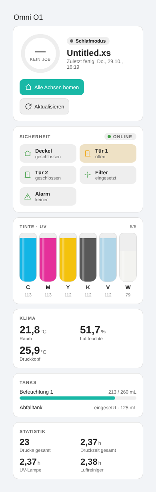
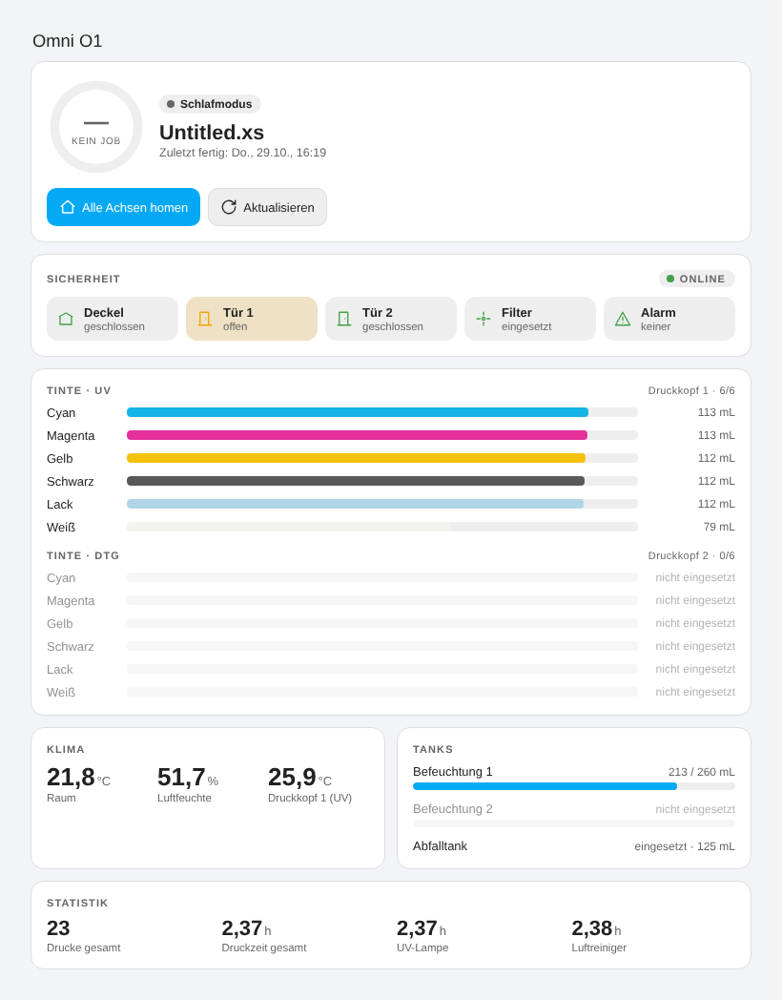

# Omni O1 Card

Lovelace-Karte für den **xTool Omni O1** (Integration [`ha-xtool-omni`](https://github.com/cmiecz/ha-xtool-omni)).
Zeigt Status und Job, Sicherheit (Deckel, Türen, Filter, Alarm), Klima, UV-/DTG-Tinte, Tanks, Statistik und optional die Werte einer Messsteckdose.
Passt sich automatisch an Handy, Tablet und PC an, folgt dem Home-Assistant-Theme (hell/dunkel) und lässt sich im visuellen Editor einstellen.



 

Funktioniert mit der Variante mit **einem Druckkopf (UV)** und mit **zwei Druckköpfen (UV + DTG)**.

## Installation mit HACS

1. HACS → ⋮ (oben rechts) → **Benutzerdefinierte Repositories**
2. URL `https://github.com/notch001/ha-omni-o1-card`, Typ **Dashboard** (früher „Lovelace"), hinzufügen
3. „Omni O1 Card" herunterladen und die Seite neu laden (Strg+F5)

### Updates

HACS prüft regelmäßig auf neue Releases und legt eine Update-Entität an. Neue Versionen erscheinen in
**Einstellungen → System → Updates** und als Benachrichtigung in Home Assistant. Dort lässt sich das Update mit einem Klick einspielen.
Automatische Benachrichtigungen sind in HACS unter *Einstellungen → Integration → HACS → Konfigurieren* sowie in den Update-Einstellungen von Home Assistant aktivierbar.

## Karte hinzufügen

Im Dashboard-Editor „Karte hinzufügen" → **xTool Omni O1**. Oder per YAML:

```yaml
type: custom:omni-o1-card
```

Die Entitäten werden automatisch gefunden. Optional:

| Option | Werte | Standard | Beschreibung |
|---|---|---|---|
| `name` | Text | – | Titel über der Karte |
| `device_id` | Geräte-ID | automatisch | Nötig, falls mehrere Geräte vorhanden sind |
| `heads` | `auto`, `1`, `2` | `auto` | Anzahl Druckköpfe. `1` blendet DTG-Tinte, Druckkopf 2 und Befeuchtung 2 aus |
| `layout` | `auto`, `stack` | `auto` | `stack` erzwingt eine Spalte |
| `density` | `comfortable`, `compact` | `comfortable` | Abstände |
| `accent_color` | CSS-Farbe | Theme-Primärfarbe | z. B. `"#19b8a6"` |
| `sections` | Liste aus `hero`, `safety`, `climate`, `ink`, `tanks`, `power`, `stats` | alle | Sichtbare Bereiche |
| `ink_style` | `tubes`, `bars` | `tubes` | Kartuschen oder Balken |
| `ink_line` | `auto`, `UV`, `DTG` | `auto` | Bei zwei Druckköpfen: welche Linie(n) |
| `ink_unit` | `ml`, `percent`, `both` | `ml` | Anzeige des Füllstands |
| `warn_below` | 0–90 | `15` | Kartusche wird unter diesem Prozentwert gelb markiert |
| `entities` | Zuordnung | – | Einzelne Entitäten überschreiben, z. B. `status: sensor.mein_status` |

Beispiel mit Überschreibung:

```yaml
type: custom:omni-o1-card
name: Omni O1
heads: 1
sections: [hero, safety, ink, tanks]
ink_style: bars
entities:
  head1: sensor.buro_xtool_omni_printer_o1_print_head_1_temperature
```

Schlüssel für `entities`: `status`, `temperature`, `humidity`, `job`, `progress`, `last_finished`, `waste`, `uv_lamp`, `air`, `prints`, `print_time`,
`head1`, `head2`, `moist1`, `moist2`, `online`, `lid`, `door1`, `door2`, `filter`, `running`, `alarm`, `home`, `refresh`, `uv_<farbe>`, `dtg_<farbe>`
(Farben: `cyan`, `magenta`, `yellow`, `black`, `varnish`, `white`).

## Messsteckdose (Strom)

Der Bereich „Strom" zeigt Leistung, Stromstärke, Spannung, Energie (heute, gestern, Monat, gesamt), Max/Ø der letzten 24 h und einen An/Aus-Schalter.
Er erscheint nur, wenn Entitäten gefunden werden.

Am einfachsten wählst du im Editor unter **Messsteckdose** das Steckdosen-Gerät aus, die Entitäten werden dann automatisch zugeordnet:

```yaml
type: custom:omni-o1-card
power_device_id: 6eed4a7f475cde8fedaf9af1879715e7
```

Einzelne Entitäten lassen sich auch direkt angeben (überschreibt die automatische Zuordnung):

```yaml
power_entity: sensor.steckdose_uv_omni_power
current_entity: sensor.steckdose_uv_omni_current
voltage_entity: sensor.steckdose_uv_omni_voltage
energy_today_entity: sensor.steckdose_uv_omni_energy_today
energy_yesterday_entity: sensor.steckdose_uv_omni_energy_yesterday
energy_month_entity: sensor.steckdose_uv_omni_energy_month
energy_total_entity: sensor.steckdose_uv_omni_energy
power_max_entity: sensor.bastelzimmer_steckdose_uv_omni_uv_omni_leistung_max_24h
power_avg_entity: sensor.bastelzimmer_steckdose_uv_omni_uv_omni_leistung_durchschnitt_24h
power_switch: switch.0xa4c138110aabffff
```

Der Schalter oben rechts im Bereich schaltet die Steckdose. Nicht erreichbare Werte werden als „—" angezeigt.

Ein Klick auf Werte, Chips, Tanks oder Kartuschen öffnet den Verlauf der Entität.

## Veröffentlichen einer neuen Version (Entwickler)

1. `VERSION` in `dist/omni-o1-card.js` erhöhen und committen
2. Tag setzen und pushen: `git tag v0.1.1 && git push origin v0.1.1`
3. Die GitHub Action „Release" erstellt das Release mit der Datei. HACS meldet daraufhin das Update.
